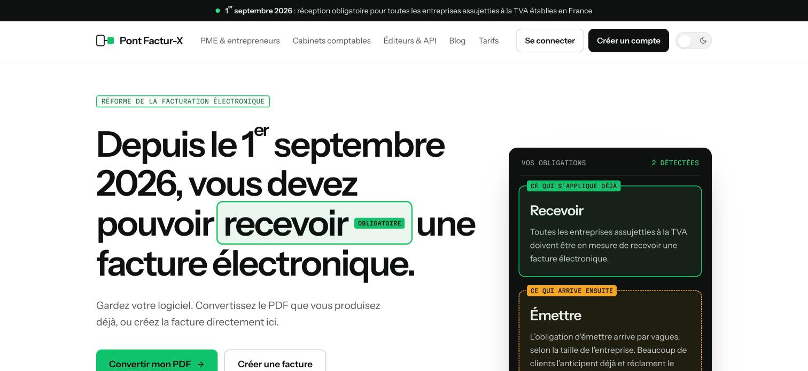
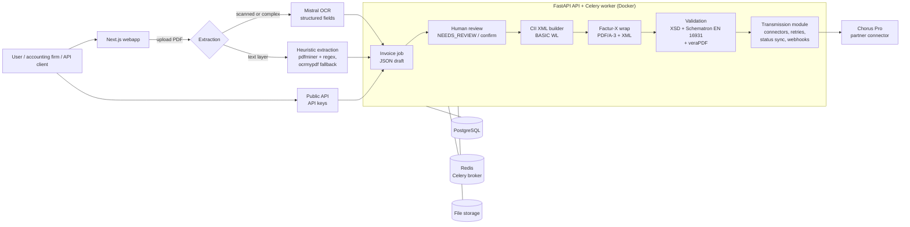

# Pont Factur-X · Architecture case study

> **Pont Factur-X** ([pont-facturx.com](https://www.pont-facturx.com)) is a B2B SaaS for the French e-invoicing reform: it turns the PDF invoices a company already produces into compliant **Factur-X** invoices, validates them, and can transmit them through an accredited platform.
> This repository documents **how it is built and why**. The product source code is private; I'm happy to walk through it live during an interview.

**Role:** creator and sole engineer (product, backend, frontend, infrastructure)
**Stack:** Python · FastAPI · Celery · PostgreSQL · Redis · Alembic · Next.js · TypeScript · Mistral AI (OCR) · Stripe · Docker · Caddy · GitHub Actions

  

---

## 1. The problem

Since September 2026, every VAT-registered company in France must be able to **receive** electronic invoices, and the obligation to **issue** them arrives in waves. Many small companies and accounting firms still produce plain PDFs from their existing software and do not want to change tools.

A **Factur-X** invoice is a **PDF/A-3 with a structured XML (CII) embedded inside**. Producing one reliably from an arbitrary PDF means solving three hard problems:

- **extraction**: real invoices are messy (scans, odd layouts, several VAT rates);
- **compliance**: the XML must pass the official **XSD and EN 16931 Schematron** rules, and the PDF must be valid **PDF/A-3**;
- **transmission**: sending to a regulated platform (Chorus Pro first) must be reliable, traceable and never duplicated.

---

## 2. Architecture overview

---

## 3. Key design decisions

### 3.1 Extraction with a human in the loop
Extraction is **best effort**, and the product is designed around that fact. Scanned or complex invoices go through **Mistral OCR**, which returns structured fields (SIRET, VAT number, totals, VAT breakdown, line items); invoices with a text layer can use a **heuristic pipeline** (pdfminer + regex, with an ocrmypdf fallback for image-only PDFs). The result is a JSON draft that can stop in a **`NEEDS_REVIEW`** state: the user checks and corrects the fields, then **confirms**, and only then is the final invoice generated.

*Why:* in invoicing, a wrong number is worse than a slow one. The AI does the typing, a person stays accountable for the values.

### 3.2 A deterministic compliance pipeline
Once the data is confirmed, everything is deterministic and runs in a **Celery worker**: CII XML generation from templates (BASIC WL profile), embedding into the PDF with the `factur-x` library, optional **PDF/A-3 conversion with Ghostscript**, then validation against the **XSD, the official EN 16931 Schematron and veraPDF**. Each validator can be switched on by configuration.

*Why:* compliance rules change and some steps are fragile (PDF/A conversion fails on many real PDFs because of fonts and transparency), so each stage is isolated, observable and can be enabled or replaced on its own.

### 3.3 Transmission as a pluggable, idempotent module
Sending an invoice to a regulated platform goes through a **connector interface** (`mock` for development, **Chorus Pro** as the first real connector) and a **partner selection strategy**. Each transmission has an **idempotency key**, failures are retried with **exponential backoff** and a maximum number of attempts, statuses are kept up to date by **polling sync**, and incoming **webhooks are deduplicated**.

*Why:* a duplicated invoice sent to the tax administration is a real business problem. The module is built so that a retry, a timeout or a redelivered webhook can never create a second invoice.

### 3.4 Product and operations around the core
- **Stripe** subscription billing, **API keys** for software vendors, guest conversions without an account, inbound email (send a PDF by email), archive and e-reporting modules
- **Alembic** migrations, a secret rotation runbook, and a **scheduled purge** job for data retention

---

## 4. Engineering workflow

- **Pull requests** with a **Quality Gate** in GitHub Actions: Ruff lint, compile check, **800+ backend tests** (pytest, 60+ test files), frontend lint and build
- Concurrency-sensitive tests are marked and reported as skipped when no PostgreSQL is available, instead of passing with false confidence
- Automated AI code review on pull requests once CI is green
- Container images published by CI; production runs with **Docker Compose behind Caddy** (automatic HTTPS) with API, worker, PostgreSQL and Redis
- Swagger / OpenAPI documentation exported for API clients

---

## 5. What I would do next

- Support richer Factur-X profiles (BASIC, EN 16931, EXTENDED) with line-level data
- Run concurrency tests against a disposable PostgreSQL in CI
- More partner connectors (accredited platforms) behind the same interface

---

## 6. Want to see the code?

The repository is private because Pont Factur-X is a live product. During an interview I can:

- walk through the extraction, validation and transmission modules live,
- show the CI quality gate and PR history,
- discuss the trade-offs between AI extraction and deterministic compliance.

📫 rayan.sekkat@gmail.com · [LinkedIn](https://www.linkedin.com/in/rayan-sekkat-3911a9294) · [Portfolio](https://portfolio-rayan-sekkat.vercel.app)
